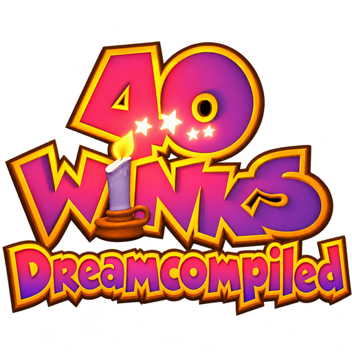

<p align="center">
  
</p>

# 40 Winks : Dreamcompiled

40 Winks : Dreamcompiled is a native PC port of the Nintendo 64 game **40 Winks**, made by **statically recompiling** the
game's code with [N64: Recompiled](https://github.com/N64Recomp/N64Recomp). It uses [RT64](https://github.com/rt64/rt64)
to render the game, with enhancements such as high framerates and widescreen.

### [Download the latest release here](https://github.com/DreaXer/40WinksRecomp/releases)

### **This repository and its releases do not contain game assets. You need your own copy of the original game to play or build this project.**

> **Version 0.2.0 is an early release.** Worlds 1 and 2 (with its boss) have been played from start to finish without
> bugs. Later worlds have not been tested yet: expect problems there, and keep a backup of your saves.

## Supported ROM

Only the **final N64 release by Piko Interactive (Europe)** is supported:

| | |
|---|---|
| Header code | `N4WZ` |
| SHA-1 | `282b97c6a6eb79535e618fc2651b6156fff65ea4` |

The earlier prototype (`N4WX`) is not supported.

## System requirements

- Windows 10 or 11, 64-bit. (No Linux or macOS build yet.)
- A GPU supporting Direct3D 12.0 (Shader Model 6) or Vulkan 1.2.
- A CPU supporting AVX.

If the game crashes on startup, update your graphics drivers first.

## How to play

1. Download `40WinksRecompiled-v0.2.0-windows.zip` from the [releases](https://github.com/DreaXer/40WinksRecomp/releases)
   and extract it anywhere.
2. Run `40WinksRecompiled.exe`.
3. Select your 40 Winks ROM when asked. It is copied to `%LOCALAPPDATA%\40WinksRecompiled\`.
4. Start the game from the launcher.

Settings, controller mappings and saves are stored in `%LOCALAPPDATA%\40WinksRecompiled\`.

## Features

- **High framerate**: the game runs at 25 frames per second; RT64 draws extra frames in between, up to your monitor's
  refresh rate (Graphics > Framerate). Camera, characters, objects, rain, particles, HUD and menus are interpolated.
  Changing the framerate has no effect on gameplay.
- **Widescreen**: Aspect Ratio Expand (default) shows more of the world in 16:9, in 1 and 2 players. The HUD can stick
  to the screen edges (HUD Placement).
- **Full-screen 4:3 views**: the 1-player view fills the whole 320×240 picture, and the 2-player split screen uses two
  full-height halves.
- **Controller Pak saves**: saving and loading work like on the console (Controller Pak emulated on port 1).
- **2-player split screen** with two controllers.
- **Film grain** option (Graphics tab), like the original console output.
- Correct sound speed and cutscene sync (the game runs at its original 50 Hz).

## Known issues

- Only Worlds 1 and 2 have been fully tested.
- Fades (screen transitions) stay at 25 frames per second.
- Several launcher options are greyed out for now (sound volume, some graphics options, mods).
- The launcher uses generic fonts and icons.

## Reporting a bug

Open an [issue](https://github.com/DreaXer/40WinksRecomp/issues) with:

- the version (for example 0.2.0) and your Windows version;
- where it happened (world, level, area) and what you did just before;
- what happened (freeze, crash, black textures, wrong sound…), with a screenshot if possible;
- your graphics settings (Framerate, Aspect Ratio);
- for a crash, the `40winks-log.txt` file next to the executable.

## Building

Building needs your own ROM: the game's code is disassembled from it, then recompiled. Windows only for now.

Requirements: Visual Studio 2026 (version 18) with the C++ workload and clang-cl, Python 3 with
[splat](https://github.com/ethteck/splat) (`pip install splat64[mips]`), and MSYS2 with `mingw-w64-x86_64-clang` and
LLVM's `ld.lld` (for the ROM relink check).

```
git clone --recursive https://github.com/DreaXer/40WinksRecomp.git
```

1. Copy your ROM to the repository root as `baserom.eur.z64` (SHA-1 above).
2. Disassemble and check the relinked ROM matches (from `decomp/`):
   ```
   python -m splat split 40winks.yaml
   python -I tools/build_rom.py
   ```
   The second command must print `OK: ROM matches`. It writes `decomp/build/40winks.elf`.
3. Build `N64Recomp.exe` and `RSPRecomp.exe` from `lib/N64Recomp` (see its README) and copy them to the repository root.
4. Recompile the game and the audio microcode (from the repository root):
   ```
   ./N64Recomp.exe 40winks.toml
   ./RSPRecomp.exe aspMain.toml
   ```
5. Run `build.bat`. The executable is written to `build-vs/40WinksRecompiled.exe`.

## Libraries used and projects referenced

- [N64: Recompiled](https://github.com/N64Recomp/N64Recomp) and
  [N64ModernRuntime](https://github.com/N64Recomp/N64ModernRuntime) (fork:
  [DreaXer/N64ModernRuntime](https://github.com/DreaXer/N64ModernRuntime), branch `40winks`)
- [RT64](https://github.com/rt64/rt64) (fork: [DreaXer/rt64](https://github.com/DreaXer/rt64), branch `40winks`)
- [RecompFrontend](https://github.com/Killklli/RecompFrontend) (fork:
  [DreaXer/RecompFrontend](https://github.com/DreaXer/RecompFrontend), branch `40winks`)
- [Donkey Kong 64: Recompiled](https://github.com/Rainchus/Donkey-Kong-64-Recompiled), whose layout and launcher this
  project is based on, and [Zelda 64: Recompiled](https://github.com/Zelda64Recomp/Zelda64Recomp)
- [splat](https://github.com/ethteck/splat) and [spimdisasm](https://github.com/Decompollaborate/spimdisasm)
- [SDL2](https://www.libsdl.org/), [RmlUi](https://github.com/mikke89/RmlUi), [SlotMap](https://github.com/SergeyMakeev/SlotMap)

Launcher artwork: photos by DreaXer, inspired by the game.

## License

GPL-3.0, see [LICENSE](LICENSE). 40 Winks is the property of its respective owners; this project is not affiliated
with them.
